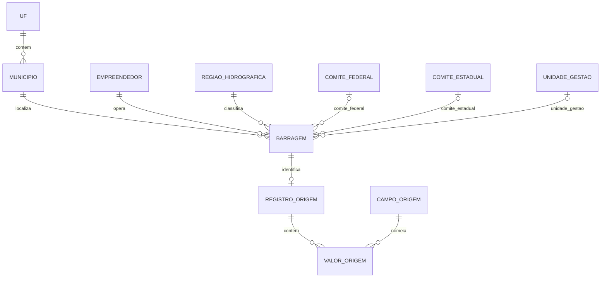

# Modelagem do banco ANA

## Camadas

A entrada tem 887 linhas e 33 colunas. cod_snisb não está vazio e é único em todas as linhas. Ele identifica barragem. As tabelas de domínio abaixo atendem às consultas; a proveniência guarda cada célula textual em uma linha própria, identificada pela linha e coluna de origem. valor_origem é uma relação normalizada de células atômicas, não uma tabela larga de 33 colunas.

## Diagrama ER

## Cardinalidades

As cardinalidades Mermaid mostram os limites permitidos pelas FKs, não a cobertura mínima da carga. O esquema permite no máximo uma linha de origem por barragem; a carga válida deve ter exatamente uma por barragem. As FKs da proveniência também permitem menos de 33 células, mas a carga válida exige 33 por registro. A Tarefa 5 valida 887 vínculos, 29.271 valores e a reconstrução completa.

| Relação | Regra |
|---|---|
| UF → municipio | Cada município tem uma UF; cada UF pode ter vários municípios. O par UF + nome distingue as 453 combinações observadas. |
| municipio → barragem | Cada barragem tem um município e UF preenchidos; município pode aparecer em várias barragens. |
| empreendedor → barragem | Cada barragem tem um empreendedor; nome de empreendedor não determina UF (26 nomes aparecem em mais de uma UF). |
| regiao_hidrografica → barragem | Cada barragem tem uma região; a região não é inferida pelo nome do rio. |
| comite_federal, comite_estadual e unidade_gestao → barragem | Campo vazio vira FK NULL na camada de consulta; cada campo é um rótulo escalar. |
| barragem → registro_origem | cod_snisb é FK UNIQUE. Uma linha de origem por barragem neste arquivo; cada barragem tem uma linha observada. |
| registro_origem e campo_origem → valor_origem | Cada célula referencia uma linha e uma coluna. A carga deve fornecer 33 células por registro, 29.271 no total. |

## Chaves e dependências por tabela

| Tabela | Chave e dependências | Justificativa de forma normal |
|---|---|---|
| uf | sigla determina a própria UF. | Não se inventa nome de estado ausente da fonte. |
| municipio | id_municipio determina nome e uf_sigla; UNIQUE (uf_sigla, nome). | Nome isolado não determina UF; as cinco colisões ficam representadas corretamente. |
| empreendedor | id_empreendedor determina nome; nome é UNIQUE na dimensão. | UF não depende do empreendedor. |
| regiao_hidrografica | id_regiao_hidrografica determina nome; nome UNIQUE na dimensão. | Região fica independente do curso d’água. |
| comite_federal | id_comite_federal determina nome; nome UNIQUE nesta dimensão. | Não se atribui uma região ao rótulo. |
| comite_estadual | id_comite_estadual determina nome; nome UNIQUE nesta dimensão. | Dois rótulos aparecem associados a mais de uma região. |
| unidade_gestao | id_unidade_gestao determina nome; nome UNIQUE na dimensão. | Não se atribui uma região ao rótulo. |
| barragem | cod_snisb determina seus atributos de consulta e FKs no recorte. | Nome não é chave: há 849 nomes para 887 linhas. cod_fiscalizador também é distinto, mas não tem regra de unicidade confirmada fora deste arquivo. |
| registro_origem | id_registro determina numero_linha e cod_snisb; ambos são UNIQUE. | Identifica a observação e seu vínculo à barragem. |
| campo_origem | ordem_coluna determina nome_original; nome_original é UNIQUE. | Cabeçalho e posição ficam com a definição da coluna. |
| valor_origem | (id_registro, ordem_coluna) determina valor_original. | A chave composta determina uma célula literal, inclusive ''. |

## 1FN, 2FN e 3FN

1FN: cada valor em valor_origem contém uma célula e cada valor analítico ocupa uma coluna simples. Rótulos com vírgulas permanecem texto; não são divididos.

2FN: em valor_origem, valor_original depende da chave composta inteira. numero_linha pertence a registro_origem; nome_original pertence a campo_origem. As tabelas com chave simples não têm dependência parcial.

3FN: os atributos não chave de cada relação dependem somente da chave daquela relação. UF foi separada de município; empreendedor não determina UF; nome do curso não determina região; código de trecho não determina nome/domínio. As tabelas de dimensão evitam repetir rótulos e não inventam dependências entre eles.

A ligação única registro_origem.cod_snisb corresponde ao conjunto atual. Se uma fonte futura trouxer várias linhas para o mesmo SNISB, remover a unicidade dessa ligação e manter cada id_registro separado.
